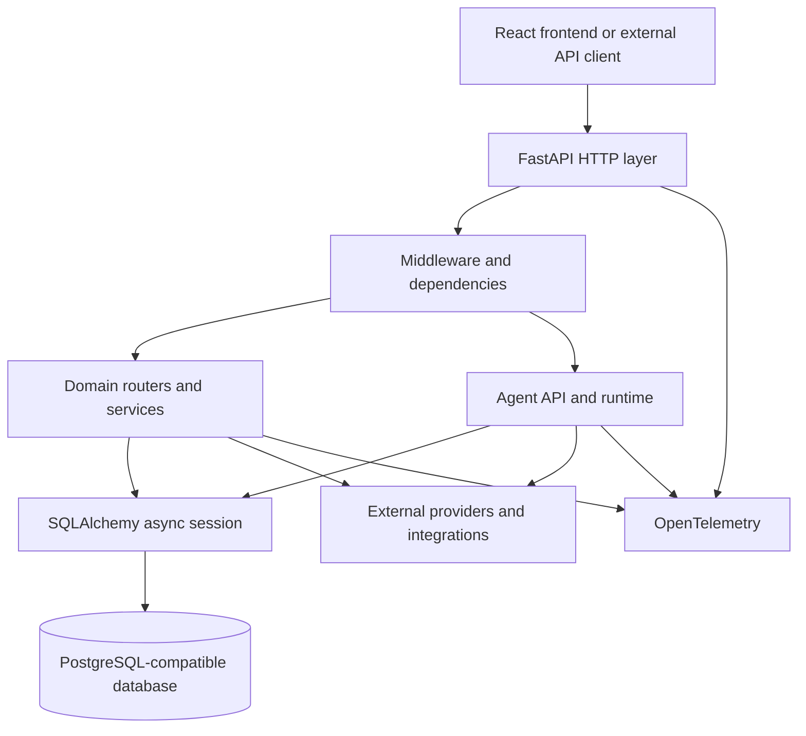
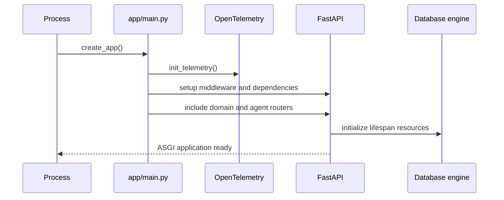
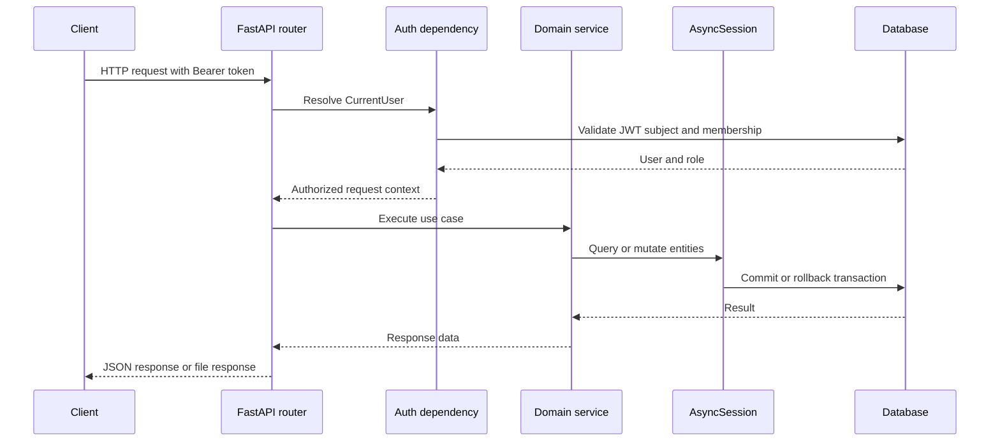

# Backend Layer
## FastAPI CRM Platform

This document describes the backend layer in `/home/suri/proj/crm/backend`: its layers, responsibilities, request flow, data model, authentication, CRM domains, integrations, operational concerns, and current implementation boundaries.

---

## 1. Backend Mission

The backend is the authoritative application boundary for:

- Identity and authentication
- Authorization and role-based access control
- CRM records and business rules
- Agent definitions, runs, tasks, approvals, and events
- Integration configuration and external service access
- Search, reporting inputs, enrichment, backfill, archive, and telemetry
- Durable persistence and API contracts for the frontend

The frontend is a client of this layer. A browser route or UI state must not be treated as an authorization boundary; backend dependencies remain authoritative.

---

## 2. Layered Architecture



### Layer responsibilities

| Layer | Main responsibility | Representative code |
| --- | --- | --- |
| HTTP/API | Routes, request parsing, response contracts, status codes | `app/*/router.py` |
| Cross-cutting | Auth, RBAC, middleware, logging, CORS, error handling | `app/dependencies`, `app/middlewares` |
| Domain/application | CRM and integration use cases | `app/*/service.py` |
| Agent boundary | Run creation, chat, approvals, agent management, dispatch | `app/agent/*.py` |
| Persistence | ORM models, sessions, migrations | `app/database`, `alembic` |
| External systems | LLMs, web, Slack, Google, Microsoft, mailbox, sync | `app/google`, `app/microsoft`, `app/slack`, `app/mailbox`, `app/sync` |
| Observability | HTTP, SQL, provider, tool, and run tracing | `app/telemetry`, `app/agent/run_lifecycle.py` |

---

## 3. Application Startup

### Entrypoint

`app/main.py` creates the FastAPI application and registers the router graph.

Startup responsibilities:

1. Initialize OpenTelemetry.
2. Create the FastAPI application with lifespan handling.
3. Configure middleware and shared dependencies.
4. Register authentication and CRM routers.
5. Register integration and administration routers.
6. Register agent routers, including unified chat, root, runner, internal dispatch, and LLM routes.
7. Instrument FastAPI requests.
8. Initialize database metadata in the current development setup.



### Configuration

`app/config/settings.py` loads environment-backed settings, including:

- `DATABASE_URL`, `DIRECT_URL`
- `SECRET_KEY` through `BETTER_AUTH_SECRET`
- `APP_URL`, `API_URL`, `BETTER_AUTH_URL`
- `REDIS_URL`
- `OLLAMA_BASE_URL`, `OLLAMA_MODEL`
- `GROQ_API_KEY`, `GROQ_MODEL`
- `AGENT_WORKSPACE_ROOT`
- `AGENT_MAX_ITERATIONS`, `AGENT_MAX_TOOL_SECONDS`
- `WEB_FETCH_TIMEOUT_SECONDS`, `WEB_FETCH_MAX_BYTES`
- `AUTH_DEV_MODE`, `ALLOWED_SIGN_IN`
- Integration credentials and telemetry settings

---

## 4. HTTP and Cross-Cutting Layer

### API conventions

- FastAPI routers define resource-specific endpoints.
- Pydantic schemas validate request and response data.
- Async route handlers use SQLAlchemy async sessions and async HTTP clients.
- Authentication is applied through `Depends(get_current_user)` where required.
- API responses are JSON unless an endpoint explicitly returns a generated file.

### Authentication

`app/auth/router.py` exposes:

- `POST /api/auth/sign-in`
- `POST /api/auth/sign-up`
- `GET /api/auth/me`
- `POST /api/auth/sign-out`
- `GET /api/auth/settings`
- `POST /api/auth/verify`

`app/auth/service.py`:

- Finds users by email.
- Verifies PBKDF2-SHA256 password hashes.
- Issues HS256 JWT tokens with a 24-hour session lifetime.
- Provides password hashing for user creation flows.

`app/dependencies/auth.py`:

- Accepts an HTTP Bearer token.
- Decodes and verifies the JWT using `SECRET_KEY`.
- Loads the user from the database.
- Resolves the primary role from `Member.role`.
- Fails closed for missing, invalid, expired, or unknown tokens.
- Supports an explicit development-only email allow-list when `AUTH_DEV_MODE` is enabled.

### Roles

```text
readonly < rep < manager < owner/admin
```

Authorization helpers include:

- `get_current_user`
- `require_role(...)`
- `assert_can_mutate(...)`

Mutation rules are role-aware. Owners and managers can mutate; representatives can mutate permitted records they own; readonly users are rejected.

### Middleware and dependencies

The backend contains middleware/dependency surfaces for:

- Authentication
- CORS
- Request logging
- General logging
- Error handling
- Pagination
- Caching
- RBAC
- Current-user access
- FastAPI, SQLAlchemy, and HTTPX instrumentation

---

## 5. Domain Layer

Most domain packages follow this shape:

```text
app/<domain>/
  router.py       HTTP endpoints
  service.py      application and business operations
  models.py       local persistence models where present
  schemas.py      request and response schemas
  contracts.py    shared contracts where present
```

### CRM core domains

#### Companies

Owns company records and company-level workflows:

- Name, domain, website, descriptions, logos, industry, location, and contact details
- Owner and primary-contact relationships
- Lifecycle stage and lead status
- Record source, activity timestamps, archive state, enrichment status
- Custom fields and field values
- Related contacts, deals, activities, messages, calendar events, and attachments

Representative package: `app/companies/`.

#### Contacts

Owns people and contact relationships:

- Name, email, phone, job title, seniority, function
- Company and owner relationships
- Lifecycle and lead status
- Social profiles and profile photo
- Enrichment and activity metadata
- Custom fields, attachments, email threads, and calendar events

Representative package: `app/contacts/`.

#### Deals

Owns sales pipeline state:

- Deal name and company relationship
- Owner, amount, currency, and expected close date
- Deal stage and stage-change timestamps
- Forecast category
- Closed-won and closed-lost state
- Deal contacts and activities

Representative package: `app/deals/`.

#### Activities

Represents CRM interaction history:

- Notes
- Calls
- Emails
- Meetings
- Tasks
- Stage changes
- Lifecycle changes
- Enrichment events

Representative package: `app/activities/`.

#### Conversations

Stores CRM-linked conversations and conversation context.

Representative package: `app/conversations/`.

### Organization and data management

- `app/fields/`: custom field definitions and values
- `app/saved_views/`: saved filters and views
- `app/search/`: cross-entity search
- `app/archive/`: archive and restore behavior
- `app/currency/`: currency configuration and reporting currency
- `app/backfill/`: batch backfill and enrichment jobs
- `app/crm/`: shared CRM helpers, bulk operations, activity stamps, and enrichment logs

### Administration

- `app/workspace/`: workspace configuration and profile
- `app/users/`: users and membership-facing operations
- `app/settings/`: settings
- `app/api_keys/`: API key lifecycle
- `app/tracking/`: tracking configuration and events
- `app/telemetry/`: telemetry configuration and records
- `app/cache/`: cache operations
- `app/dashboard/`: dashboard-facing aggregation endpoints

---

## 6. Integrations Layer

The backend exposes configuration and operation surfaces for:

- `app/slack/`: Slack connection and messaging integration
- `app/sso/`: SSO configuration
- `app/mailbox/`: mailbox connection and mail workflows
- `app/google/`: Google integration
- `app/microsoft/`: Microsoft integration
- `app/sync/`: synchronization workflows
- `app/enrichment/`: enrichment services and records
- `app/google/` and `app/microsoft/`: provider-specific integrations
- `app/telemetry/`: observability and operational data

External access should remain behind service boundaries rather than being performed directly by route handlers wherever possible.

---

## 7. Persistence and Database Layer

### Sessions

`app/database/session.py` provides:

- Async SQLAlchemy engine
- `async_sessionmaker`
- Declarative `Base`
- Async database dependency
- Commit, rollback, and close handling

### ORM model groups

`app/database/models.py` contains shared models for:

- Users and members
- Companies, contacts, deals, and activities
- Conversations and communication records
- Agent definitions and versions
- Agent triggers, runs, tasks, events, actions, and approvals
- LLM call logs and builder artifacts
- Workspace and custom-field state

### Migrations

Alembic migration files live under:

```text
alembic/
  env.py
  script.py.mako
  versions/
```

Migrations provide versioned schema changes for agent approval, run input, subagent relationships, and other runtime features.

### Database request flow

```text
HTTP route
  -> dependency creates AsyncSession
  -> service executes SQLAlchemy query or mutation
  -> transaction commits on success
  -> transaction rolls back on error
  -> response schema serializes result
```

---

## 8. Agent API Boundary

The agent API is part of the backend but is described separately in [agentic.md](agentic.md).

### Public agent routes

`app/agent/router.py`:

- `GET /api/agents/`
- `GET /api/agents/{agent_id}`
- `POST /api/agents/{agent_id}/run`
- `POST /api/agents/{agent_id}/runs/{run_id}/cancel`
- `GET /api/agents/{agent_id}/history`
- `GET /api/agents/{agent_id}/tasks`
- Agent pause, resume, archive, restore, delete, and dispatch operations

`app/agent/unified_router.py`:

- `POST /api/agents/unified/chat`
- `POST /api/agents/unified/tasks/{task_id}/approve`
- `GET /api/agents/unified/runs/{run_id}/approvals`
- `POST /api/agents/unified/runs/{run_id}/approvals`

`app/agent/internal_router.py`:

- `POST /internal/crm/dispatch`
- `GET /internal/crm/dispatch-health`
- `POST /internal/crm/agent-dispatch`
- `POST /internal/crm/builder-dispatch`
- `POST /internal/crm/cancel-run`

### Direct agent family routes

- `/api/agents/root/...`: direct CRM research, enrichment, field, contact, and brief operations
- `/api/agents/runner/...`: generated file serving and runner-facing surfaces
- `/api/agents/llm/...`: LLM status and provider-facing endpoints

The direct family routes and canonical LangGraph execution path coexist. A direct route is not automatically a canonical registry tool.

---

## 9. Request Lifecycle



### Agent request variation

```text
Client
  -> unified agent route
  -> AgentRun and AgentTask persistence
  -> worker and agentic runtime
  -> tools or approval
  -> durable result
  -> ChatResponse
```

---

## 10. Observability and Operations

OpenTelemetry spans are used across:

- FastAPI requests
- SQLAlchemy database operations
- HTTPX external requests
- LLM calls
- Tool execution
- Run lifecycle transitions

Important run attributes include:

- `run.id`
- `run.from`
- `run.to`
- LLM provider and model
- Input and output token counts
- Estimated cost
- Tool name and risk
- Tool success state

Operational endpoints include health, dispatch health, telemetry, cache, tracking, and run history surfaces.

---

## 11. Testing and Tooling

Backend configuration:

- Python `>=3.11`
- Pytest and pytest-asyncio
- Async test mode enabled
- Test discovery under `tests/`
- HTTPX test client support
- Coverage support through pytest-cov

Important test themes:

- CRM CRUD and domain behavior
- Authentication
- Agent root and runner surfaces
- Tool registry behavior
- SSRF protection
- CRM query allow-listing
- Agent run and approval behavior
- LangGraph engine behavior

---

## 12. Current Limitations

The following boundaries should be stated clearly when presenting the backend:

- Some service methods still return placeholders or synthetic responses.
- Dispatch bridge methods exist but some paths are still stubs or incomplete.
- The frontend currently exposes builder routes that must remain aligned with backend router registration.
- A generic CRM mutation tool is not currently registered in the canonical agent `ToolRegistry`, although direct root-agent mutation endpoints exist.
- Frontend route protection and token-expiration handling need strengthening; backend auth remains the enforcement boundary.
- Development database metadata creation is present in lifespan code; production deployments should use controlled migrations.

---

## 13. Backend Design Principles

1. Keep authentication and authorization in the backend.
2. Keep domain rules inside services and typed contracts.
3. Keep persistence transactional and explicit.
4. Keep integrations behind dedicated modules.
5. Keep agent side effects behind canonical, policy-aware tools.
6. Emit enough events and telemetry to reconstruct behavior.
7. Return explicit capability errors instead of fabricated success.
8. Preserve a clean boundary between direct legacy routes and the durable agent runtime.


Create an 18-slide technical presentation titled "Agentic CRM for SMEs". Audience: faculty, investors and senior engineers who will ask hard technical questions. Rule for every slide: answer the likely technical questions on the slide itself (what it is, how it works, why this choice, what the limits are). Use compact diagrams, tables and big stat callouts instead of paragraphs. Style: modern, dark navy with teal and indigo accents, clean sans-serif, no stock photos of people. Be honest about limitations; do not invent any statistic, benchmark or cost figure that is not in this brief.

SLIDE 1 - Title
"Agentic CRM for SMEs". Subtitle: AI agents inside the CRM, optional per action, human-approved, durable and auditable. Tagline: Research • Qualification • Outreach • Calling • Conversation Analysis.

SLIDE 2 - What is a CRM and where is it used?
CRM = system of record for customer interactions. Three blocks: Store (companies, contacts, deals, activities), Track (pipeline, forecasts, emails, calls), Report (dashboards, win rate). Stats: 91% of companies use CRM tools; market projected at $126.17B in 2026 (DemandSage, 2026). Users: sales, marketing, support, and SMEs that often have no dedicated sales-development staff.

SLIDE 3 - Why traditional CRM falls short (data)
CRMs are passive: a human does the work, then updates the database. Stat cards with sources:
- 83% of companies use AI features in CRM, but mostly shallow rules, reminders and basic scoring; AI/big-data use in CRM projected to grow 97% from 2025 to 2030 (SLT Creative, 2026).
- 15-25 manual dials per hour per human SDR vs 100-500+ simultaneous AI voice calls; SMBs under 50 employees are the fastest-growing AI-calling segment, +67% year over year (Auto Interview AI, 2026).
- +26% win rate for sellers using conversation-intelligence tools (Gong Labs); Forrester: +15% win rate, 20% shorter sales cycles (SalesHive, 2026).
Takeaway: research, qualification and follow-up remain manual, and SMEs cannot staff them.

SLIDE 4 - Validating the problem: incumbents and the connector model
HubSpot has added AI features recently, but not fully agentic or end to end. Salesforce offers AI through connectors that link external AI assistants to the CRM. Comparison table, "Connector model" vs "Native platform (ours)": where the AI runs (outside vs inside); data access (through a connector, scoped by connector auth vs same database and same RBAC as the user); approvals (defined by the external assistant vs enforced by our tool registry); audit trail (split across two systems vs one run history in our database); latency and failure points (extra network hop vs in-process). Mark the HubSpot and Salesforce rows as based on public announcements, to be verified before presenting.

SLIDE 5 - Problem statement and design principle
Gap: a CRM that gives control, not just automation. (a) AI execution of research, qualification, outreach and calling is optional, per action. (b) AI-driven and manual calls share one conversation-analysis pipeline. (c) Every high-impact or external-facing action is gated behind explicit human approval. Design principle: "The model proposes. Typed tools, authorization, approval policy, durable state and verification decide what happens."

SLIDE 6 - System architecture (diagram)
Flow: User -> React UI -> FastAPI -> JWT auth + RBAC -> (CRM domain services | Agentic runtime) -> PostgreSQL. Agentic runtime -> LLM provider (Ollama local, Groq fallback), Tool Registry, Retell (voice). Three boundaries: Frontend (UI, forms, chat, approvals), Backend (identity, authorization, business data, integrations, APIs; the authoritative boundary), Agentic layer (durable runs, LangGraph, tools, approvals, subagents). Note: the UI is never an authorization boundary; the backend enforces everything.

SLIDE 7 - Technology stack and why each choice
Table Layer | Technology | Why:
Frontend | React 19, Vite 8, React Router 7, Tailwind CSS 4 | fast component UI, URL routing
Backend | Python 3.11+, FastAPI, Uvicorn | async I/O, dependency injection, Pydantic validation
Persistence | PostgreSQL, SQLAlchemy 2 async, Alembic | transactions, versioned migrations
AI orchestration | LangGraph + langgraph-checkpoint-postgres | checkpointed graph state, resumable runs, interrupts for approval
LLMs | Ollama (local default, llama3.1) with Groq fallback | data privacy option plus availability fallback
Integrations | HTTPX, Retell, Slack, Google, Microsoft, mailbox | external services behind service modules
Observability | OpenTelemetry | traces for HTTP, SQL, LLM calls, tools, run transitions
Testing | Pytest, pytest-asyncio | CRM, auth, registry, SSRF, approvals, engine tests

SLIDE 8 - Backend design: security and data
Layers: HTTP routers -> middleware and dependencies -> domain services -> async SQLAlchemy -> PostgreSQL. Auth: POST /api/auth/sign-in issues HS256 JWT with 24-hour lifetime; PBKDF2-SHA256 password hashes; token decoded and user loaded from the database on every request; fails closed on missing, invalid, expired or unknown tokens. Roles: readonly < rep < manager < owner/admin; owners and managers can mutate, reps can mutate records they own, readonly is rejected. Domains: companies, contacts, deals, activities, conversations, custom fields, saved views, search, archive, currency, backfill, workspace, users, API keys, telemetry. Transactions commit on success and roll back on error.

SLIDE 9 - Data model
ER-style diagram: User/Member; Company, Contact, Deal, Activity (CRM core); AgentDefinition -> AgentVersion; AgentRun -> AgentRunEvent; AgentTask (durable queue); AgentApproval; LLMCallLog. Explain: graph_thread_id equals run_id, so the LangGraph checkpoint is keyed to the run and survives crashes; AgentRunEvent has a sequence number so history can be reconstructed; AgentRun has parent_run_id and child_run_ids for subagents.

SLIDE 10 - Agent runtime: how a request becomes a durable run
Pipeline: POST /api/agents/unified/chat -> AgentRun + AgentTask rows -> AgentWorker claims task -> WorkerExecutor loads run by payload.run_id -> LangGraphEngine.start_run -> graph loops -> result. Engine contract (start_run, resume_run, cancel_run, get_state) keeps the API independent of LangGraph. Triggers can also enqueue work on company creation, contact creation, upcoming meetings, backfills. Honest note: some dispatch/poke bridge paths are still incomplete; the durable task and run model exists.

SLIDE 11 - LangGraph execution loop and limits
Two-node graph: agent node <-> tools node. Agent node: stop on error or iteration limit, call LLMService with tool schemas, append tool calls or final answer. Tools node: resolve approvals first, execute through registry, capture errors as tool results (the run does not die), track generated files, append ToolMessage. State: messages, run_id, agent_id, user_id, iteration, files, error, depth. Limits: max 15 iterations (AGENT_MAX_ITERATIONS), tool timeout (AGENT_MAX_TOOL_SECONDS), subagent depth 3. Native structured tool calls, no scraping tool calls out of free text.

SLIDE 12 - Run state machine and failure handling
State diagram: QUEUED -> RUNNING -> (WAITING_FOR_APPROVAL <-> RUNNING) -> SUCCEEDED | FAILED | CANCELLED. Table "What if...": worker crashes -> run history is rebuilt from ordered events and the graph resumes from the PostgreSQL checkpoint; LLM provider down -> fall back from Ollama to Groq if configured, otherwise the run fails with a recorded error; tool errors -> returned to the model as a result so it can recover; user cancels -> cancel_run works on queued, running or paused runs; iteration limit hit -> run ends with a recorded reason.

SLIDE 13 - Tool registry and safety
Registry = single source of truth: name, JSON schema, risk tier, async handler. Flow: LLM tool call -> lookup (unknown tool rejected) -> Pydantic validation -> risk tier -> execute | interrupt for approval | blocked. Table of tools with risk: ask_question, todo, finish_run (safe); query_crm, read_crm_record, inspect_run (read-only); read_file, glob, grep (workspace-scoped); web_search, web_fetch (constrained, SSRF-checked); create_crm_activity, write_file, post_slack_message (approval required); spawn_subagent (depth-limited). CRM queries are an allow-list (list_companies, list_deals, search_contacts, search_companies, deal_pipeline, contact_timeline, company_contacts, deal_summary); unknown operations and unexpected parameters are rejected. No arbitrary Python or shell execution exists in the tool set.

SLIDE 14 - Human-in-the-loop approval (exactly-once)
Flow: model proposes a side-effect tool -> graph interrupts with tool, arguments and call id -> status WAITING_FOR_APPROVAL -> UI shows pending tool -> user approves or denies via POST /api/agents/unified/runs/{run_id}/approvals -> resume_run from checkpoint. Key invariant: all approval gates in a batch are resolved before any tool in that batch executes, so an already-executed side effect is never replayed on resume. Approval record stores run, tool call id, tool name, arguments, status, approver and timestamps (audit trail).

SLIDE 15 - How we answer: four worked examples
Four short flows: (1) CRM research (read-only, no approval); (2) three-month sales report (allow-listed queries, aggregate, approval before write_file); (3) pitch deck (CRM facts plus web context, optional subagent, approval before write, cite sources and dates); (4) update company email: resolve company, show old value, check role, approval-gated mutation, re-read and verify. State clearly that a generic CRM field-update tool is not yet registered in the canonical registry, so the agent must report a capability gap instead of claiming success.

SLIDE 16 - Current limitations (stated honestly)
Some service methods still return placeholder responses; some dispatch bridge paths are stubs; no generic CRM mutation tool in the registry yet (direct root-agent endpoints exist); frontend has no protected-route wrapper, does not validate the stored token on startup, and has a demo-token fallback that must be disabled in production; database metadata is created at startup in development and production should use Alembic migrations only; per-agent tool allow-lists and data-scope enforcement need strengthening; end-to-end tests for approval, resume, cancellation and worker recovery are still to be added. Pair each with its planned fix.
SLIDE 17 - Future work (1/3): subagent spawning
Already built, to be extended. spawn_subagent creates a durable child AgentRun with parent_run_id and a child AgentTask; the target agent must be LIVE; maximum depth is 3; the child result returns to the parent's tool call; parent and child can be queried through child_run_ids. Planned: parallel specialist subagents (Research, Qualification, Outreach, Conversation Analysis) running at the same time, each with its own tool allow-list, iteration budget and data scope, results merged by the parent, and per-subagent cost and trace attribution. Diagram: parent run fans out to 3 child runs, results merge back. Answer upfront: a child is a durable run in the database, not an in-memory callback, so it survives restarts and shows up in run history.

SLIDE 18 - Future work (2/3): Jev (TypeSafe System One model) as our fast decision layer
What Jev is (source: TypeSafe blog, Sep 15, 2026; early access): a "System One" model that makes fast, structured decisions that software can use directly. Think of it as a frontier-intelligence function call: unstructured state in, typed probabilistic decisions out. It gives up free-text generation. Output types are defined in advance, so type errors cannot occur, and every answer comes with calibrated probabilities and confidence scores. Trained with Reinforcement Learning for Calibrated Decisions (RLCD); samples all outputs in parallel. TypeSafe-reported figures: 70-500 ms end-to-end response; input $0.042 per million tokens, output tokens free; supports up to 255 choices per decision.

Split of responsibilities (diagram): LLM (Ollama/Groq) = System 2: plans, writes, converses. Jev = System 1: classifies, scores, routes, extracts, verifies. Plain code = branching on Jev's probabilities. The tool registry and approval gate stay unchanged.

Where we can use Jev, and why (table: Decision point | Today | With Jev | Benefit):
- Intent routing to agent or tool family | LLM call or keywords | typed class with confidence | milliseconds instead of seconds; no parsing errors
- Company disambiguation ("Acme" matches several records) | LLM picks | choice among up to 255 candidates with probabilities | if confidence is low, trigger ask_question instead of guessing
- Lead qualification | LLM free-text reasoning | typed fit, intent and urgency scores with calibrated probabilities | consistent, comparable across leads, loggable
- Approval triage on proposed tool calls | tier only (safe / approval_required / blocked) | extra risk and confidence score shown to the approver; low confidence escalates to a human | stricter, never looser; tiers still decide
- Conversation analysis (conversion likelihood, objection type, next steps) | LLM over transcript | typed extraction; fast enough to run during a live call | real-time call assist
- Verification and guardrails (check a draft or claim against CRM evidence; detect prompt injection in web_fetch content) | none or LLM self-check | independent verifier call | separate check instead of the same model grading itself
- Bulk enrichment and backfill (industry, seniority, lifecycle stage across all records) | slow, costly per record | map-reduce over all records | cost per record low enough to run on everything
- Reply and inbox classification | manual | typed label | automation
Where we keep the LLM: drafting emails, call scripts, reports, pitch decks (anything that needs generated text).

Why it fits our design: typed outputs match our "typed tools" principle; confidence scores turn approval into a policy ("below X% confidence, ask a human"); probabilities can be stored in AgentRunEvent for audit.

Honest caveats (must appear on the slide): proposed, not yet implemented; early-access hosted service; speed, cost and quality figures are vendor-reported and measured on TypeSafe's own workflow evals, with reference answers from other LLMs, so we must reproduce them on our own labelled CRM data; "cannot hallucinate" applies to output type and schema, not to the correctness of a judgment, which is why calibration matters; sending CRM data to a third-party API is a privacy decision compared with local Ollama (needs a data-handling review); fallback to the LLM if the service is unavailable. Rollout plan: shadow mode (log Jev's decision next to the LLM's), measure agreement and calibration on our data, then switch low-risk decisions first (routing, classification), then qualification, and only then approval triage as an additional signal.

SLIDE 19 - Roadmap and close
Table Next | Later. Next: approval-aware CRM mutation tool (company, contact, deal updates); Retell voice-call tool behind an approval gate; protected routes and token validation in the frontend; per-agent tool allow-lists; end-to-end tests for approval, resume, cancellation and worker recovery. Later: parallel subagent teams; Jev decision layer in shadow mode, then production; evaluation harness comparing LLM-only and LLM+Jev on accuracy, latency and cost using our own data; richer artifacts (PPTX, PDF); multi-channel outreach. Closing line: "Not a CRM with an AI bolted on. A CRM where AI is optional, native, and always under human control."

Keep each slide dense but scannable: tables and diagrams over paragraphs, sources in small text under stats, and a small "Limitation" tag wherever a feature is incomplete.